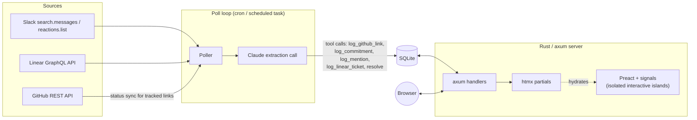
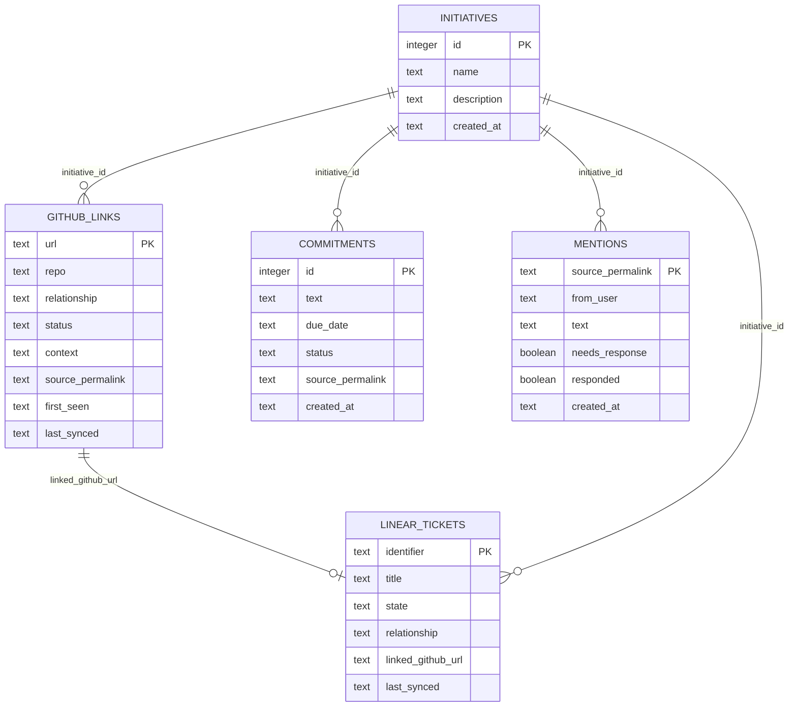
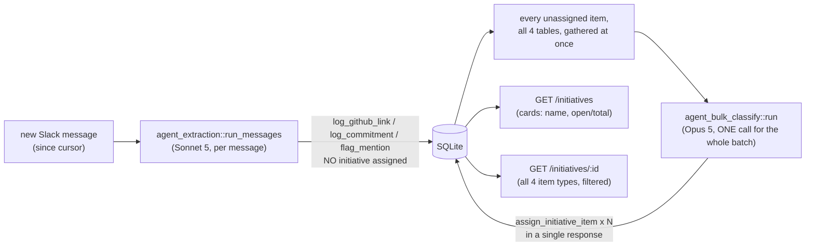
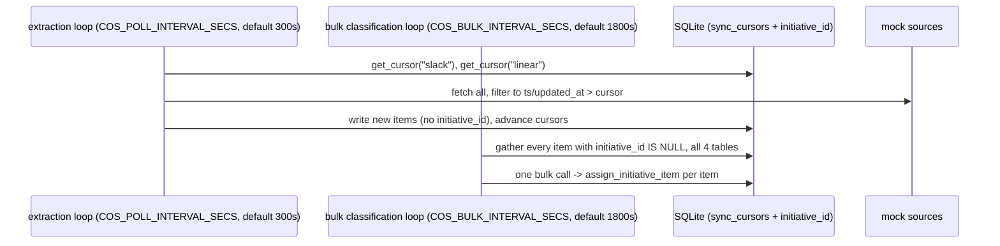
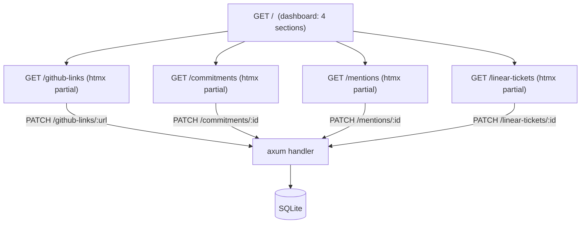
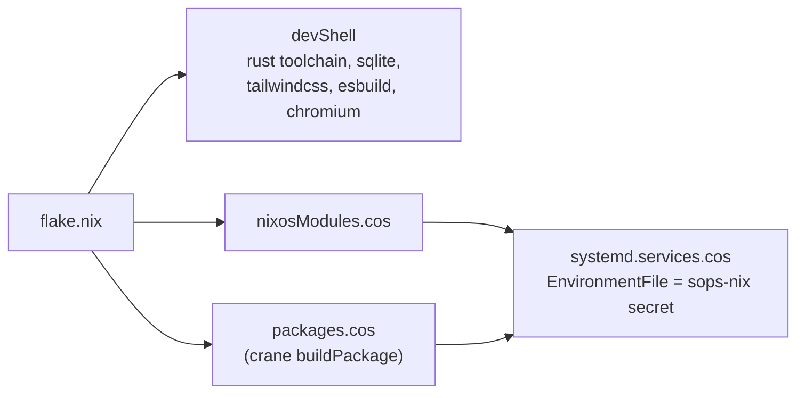

# cos — chief of staff

Tracks GitHub links you're involved in, commitments you make, and asks/mentions
directed at you across Slack and Linear, and surfaces them in a small local
dashboard.

## Scope (v1)

- Capture: Slack (user-token polling) + Linear (personal API key polling) +
  GitHub (status sync for tracked links)
- Extraction: Claude, given tool calls that write directly to SQLite
- Storage: SQLite, single file
- UI: simple CRUD dashboard — view, edit status, resolve, delete

No real-time push in v1. Everything is a poll loop on a schedule.

## System overview



## Ingestion sequence

```mermaid
sequenceDiagram
    participant Cron as Scheduler
    participant Poll as Poller
    participant Slack as Slack API
    participant Linear as Linear API
    participant Claude as Claude (tool-use)
    participant DB as SQLite

    Cron->>Poll: tick (e.g. every 5 min)
    Poll->>Slack: search.messages / reactions.list (since last_synced)
    Poll->>Linear: viewer.notifications / assignedIssues (since last_synced)
    Poll->>Claude: raw messages + tool defs
    Claude-->>DB: log_github_link / log_commitment / log_mention / log_linear_ticket
    Note over Claude,DB: Claude decides relevance;<br/>no-op if nothing worth logging
    Poll->>DB: update last_synced cursor
```

## Data model



Every item table (`github_links`, `commitments`, `mentions`, `linear_tickets`)
carries a nullable `initiative_id`. One initiative per item, not a
many-to-many tag table — simplest thing that answers "what's open under this
initiative," and cheap to widen into a join table later if an item ever
genuinely needs to belong to more than one.

## Initiatives

The cross-cutting grouping a PR, a Slack ask, and a Linear ticket can all
belong to ("the ledger dedupe fix"), so you can look at one thing instead of
four lists.

Classification is deliberately a separate, later stage from extraction — see
Polling below for why.



Two parallel implementations, chosen at runtime by whether `ANTHROPIC_API_KEY`
is set (`agent::AnthropicClient::is_configured`):

- **No key**: `extraction.rs` (regex/keyword rules) + `classify.rs` (group by
  shared GitHub repo, one item at a time). Deterministic, free, no network
  call — what runs by default and in CI.
- **Key present**: `agent_extraction.rs` (triage) + `agent_bulk_classify.rs`
  (initiative assignment), real `POST /v1/messages` tool-use calls (raw HTTP
  via `reqwest`; there's no official Anthropic Rust SDK) — but at two
  different model tiers for two different jobs:
  - `agent_extraction`: **Sonnet 5**, `effort: "low"`, one call per Slack
    message. Decides PR relationship (authored / reviewing / mentioned),
    whether it's a commitment, whether it needs a response. Does **not**
    decide initiative — that's deferred entirely to the bulk pass.
  - `agent_bulk_classify`: **Opus 5**, `effort: "high"`, one call for the
    *entire* batch of currently-unassigned items across all four tables.
    Every item is listed in a single prompt; Opus responds with one
    `assign_initiative_item` tool call per item in the same turn. Seeing
    everything at once is the point: it can consolidate items that only make
    sense together (e.g. an infra PR, two unrelated-looking Slack mentions,
    and a Linear ticket all turned out to be the same "Release Cut
    Readiness" effort) in a way a one-item-at-a-time pass structurally
    can't — a prior per-item-Sonnet version of this classifier split that
    same set into two initiatives; the bulk Opus pass merged them correctly.
    Skipped entirely (no API call) when nothing is unassigned.

Both paths write through the same `db::log_*` / `db::assign_*` primitives, so
the UI and schema don't know or care which one ran.

## Polling

Two independent `tokio::spawn` loops, different cadences, matching the
cost/frequency split above:



`poller::run_extraction` and `poller::run_bulk_classification` are each a
single code path reused by three triggers: the startup calls in `main.rs`
(run once immediately, so the UI isn't empty on first boot), their own
interval loop, and — for classification only — the "Run classification"
button (a manual, on-demand bulk pass).

Each source (`slack`, `linear`) has a row in `sync_cursors` holding
`last_synced_at`. A missing row defaults to the epoch, so a brand-new
database's first extraction cycle is a full backfill — "seed" isn't a
separate code path, it's just what the cursor default produces. Every cycle
advances both cursors to the cycle's own timestamp (not the max item
timestamp), and only items newer than the cursor get extracted — this is
what makes the interval loop safe to run against unique-free tables like
`commitments`: without it, every tick would re-insert every historical
commitment again. GitHub status sync isn't cursor-gated — it's "what's the
current state of tracked links," not an event feed, so it always runs in
full each extraction cycle.

Timestamps are UTC with a `Z` suffix everywhere (`util::now()`), matching the
mock fixtures' format, so cursor comparisons are plain string comparison —
no parsing, and no local-timezone-offset bugs from mixing `Local::now()`
output with `Z`-suffixed fixture data (an earlier version of this code had
exactly that bug before the cursor comparisons existed to expose it).

What's still mock: the sources themselves (`mock::slack_messages()` etc. are
static fixtures, not live API calls) — the polling *mechanism* (cursor,
interval loop, extraction/classification dispatch) is real and will work
unchanged once `src/mock.rs`'s fetch functions are swapped for live
Slack/Linear API calls.

## Environment variables

`ANTHROPIC_API_KEY` is live — set it and extraction/classification run
through real Claude tool-use calls instead of the rule-based fallback. The
other three aren't read yet; the app still runs entirely on mock Slack/Linear
/GitHub fixtures. Documented now so the NixOS module's `environmentFile`
(sops-nix) option has a known target once each poller goes live:

| Variable | Used by |
|---|---|
| `SLACK_USER_TOKEN` | live Slack poller (`search.messages`, `reactions.list`) |
| `LINEAR_API_KEY` | live Linear poller |
| `GITHUB_TOKEN` | live GitHub status-sync job |
| `ANTHROPIC_API_KEY` | real extraction + initiative classification (replaces `extraction.rs` / `classify.rs` heuristics) |

## Extraction tool calls

Claude gets these as tool definitions during the extraction pass; it calls
whichever apply to a given message/event, or none:

| Tool | Purpose |
|---|---|
| `log_github_link(url, relationship, context, source_permalink)` | merge by `url` — see below |
| `log_commitment(text, due_date, source_permalink)` | insert |
| `log_mention(source_permalink, from_user, text, needs_response)` | upsert by `source_permalink` |
| `log_linear_ticket(identifier, relationship, linked_github_url)` | upsert by `identifier` |
| `resolve(table, id)` | mark done / responded / merged |

Most of these are a thin Rust fn doing `INSERT ... ON CONFLICT DO UPDATE SET
excluded.*` — a second mention of the same thing just overwrites with
whatever the latest call said. `log_github_link` is the one exception,
because blind overwrite was actively wrong there: the LLM classifies each
message in isolation with no memory of what's already tracked, so a PR
jonathan opened (`authored`) could get silently reclassified to `mentioned`
by someone else later casually referencing it, and a `merged` PR could get
reset to `open` because extraction always passes `"open"` as its default
status. So `log_github_link` does an explicit read-then-merge instead of a
raw upsert:

- `relationship` only ever upgrades (`authored` > `reviewing` > `mentioned`
  by rank) — a weaker new signal can't demote a stronger existing one.
- `status` isn't touched by this path at all — it's owned by
  `sync_github_status` (live state) and the manual Resolve action.
- `context` accumulates distinct notes (capped at the last 3, `" | "`
  joined) instead of replacing the previous one.
- `first_seen` / `source_permalink` stay pinned to whichever message first
  reported the PR.

This lives in `db::log_github_link` itself, so both the heuristic and
agent-based extraction paths get it for free — same guarantee either way.

## Web app

Plain CRUD, server-rendered, no SPA framework:

- **axum** router, one module per resource (`github_links`, `commitments`,
  `mentions`, `linear_tickets`), each exposing list/edit/delete handlers
- **tower** middleware: tracing, compression; no auth (localhost-only)
- **htmx** for all list/filter/delete/status-toggle interactions — handlers
  return HTML fragments, not JSON
- **Tailwind** for styling, compiled once at build time (no CDN/JIT at runtime)
- **Preact + signals** only where htmx genuinely isn't enough — e.g. an
  inline due-date editor with client-side validation before submit. Each such
  case is a standalone island: a tiny script mounted into a `<div
  data-island="...">`, not a shared app shell. Default to htmx; reach for an
  island only when state needs to live in the browser between requests.



## Project layout (proposed)

```
cos/
  flake.nix
  flake.lock
  nix/
    module.nix           # nixosModules.cos
  Cargo.toml
  src/
    main.rs              # axum app, router assembly
    db.rs                # sqlite pool, schema migrations
    models/
      github_link.rs
      commitment.rs
      mention.rs
      linear_ticket.rs
    routes/
      dashboard.rs
      github_links.rs
      commitments.rs
      mentions.rs
      linear_tickets.rs
    extraction/
      tools.rs           # tool defs + handlers for Claude tool-use
      poller.rs           # Slack/Linear/GitHub poll loop
  templates/              # askama or minijinja templates (htmx fragments)
  static/
    tailwind.css          # built output
    islands/              # preact islands, one file per interactive widget
  tailwind.config.js
  migrations/
```

## Decisions

- **Templating: minijinja**, not askama. Askama embeds templates at compile
  time, so every markup tweak forces a full `cargo build` — a bad loop for an
  agent iterating on fragments. Minijinja loads templates from disk at
  runtime; editing a `.html` file and refreshing the browser is enough.
- **Poll loop**: a `tokio::spawn`ed loop inside the same binary, no separate
  scheduler process.
- **Secrets**: read directly from the process environment
  (`std::env::var`), no `.env`/`dotenvy`. Locally, the CRUD/UI stages don't
  need any secrets at all; only the pollers do, and those are only exercised
  in the deployed NixOS service, where `sops-nix` supplies an
  `EnvironmentFile` to the systemd unit. No secret material lives in the repo
  or the dev shell.
- **Schema: `rusqlite_migration`**, not inline `CREATE TABLE IF NOT EXISTS`.
  The original version ran a big `execute_batch` of `IF NOT EXISTS` DDL on
  every startup — fine for a brand-new file, but silently a no-op on an
  existing one, so adding a column (e.g. `initiative_id`) to an
  already-created table did nothing and broke on the next query. Hit that for
  real mid-project and had to manually delete the dev DB. Now schema changes
  are an ordered `Vec<M>` tracked via SQLite's `user_version` pragma (no
  hand-rolled migrations table) — `db::open` calls `.to_latest(&mut conn)`,
  which applies whatever's pending and is a true no-op otherwise. Future
  schema changes are a new `M::up(...)` appended to the list, never an edit
  to an existing one.

## Nix



- **devShell**: rust toolchain (via rust-overlay/fenix), `sqlite`,
  `tailwindcss`, `nodejs`/`esbuild` (bundling the Preact islands),
  `cargo-watch`, and `chromium` for headless screenshotting. No network
  fetches at test time — everything pinned via the flake.
- **Build: crane**. `craneLib.buildPackage` with a separate `cargoArtifacts`
  derivation so dependency compilation is cached independently of source
  changes — matters once the poller/extraction code pulls in more crates.
  Exposed as `packages.default` / `packages.cos`.
- **NixOS module** (`nixosModules.default`): options for `enable`, `package`
  (defaults to this flake's `packages.cos`), `port`, `dataDir` (SQLite file
  location, via `StateDirectory`), and `environmentFile` (passed straight to
  systemd's `EnvironmentFile=`, pointed at a `sops-nix` secret path in the
  consuming NixOS config). The service runs with `DynamicUser = true`.
- **Headless browser testing**: `chromium --headless=new --screenshot=out.png
  --window-size=1280,800 http://localhost:$PORT` from the devShell is enough
  to visually verify dashboard/fragment rendering — no webdriver server, no
  extra deps. Since the app is server-rendered htmx, functional CRUD checks
  (create/patch/delete) are just `curl`/`httpie` against the routes; the
  browser is only needed to confirm layout and the Preact islands actually
  mount. This is what I'll use to check in with screenshots at each stage
  instead of describing UI changes in prose.

## Suggested build stages

1. `flake.nix` (devShell + crane package skeleton) + axum app scaffold +
   SQLite schema/migrations + static dashboard shell (no data yet) —
   screenshot the empty shell to confirm the toolchain works end to end
2. CRUD routes + minijinja/htmx partials for all four resources, seeded with
   fake data — screenshot each section
3. `nixosModules.cos` + systemd unit sketch (not deployed yet, just
   evaluable: `nix flake check`)
4. Linear poller + extraction tool calls (lowest-friction source, no app
   approval needed)
5. Slack poller once app is approved
6. GitHub status-sync job for tracked links
7. Any Preact islands, only if a CRUD interaction proves awkward in pure htmx
