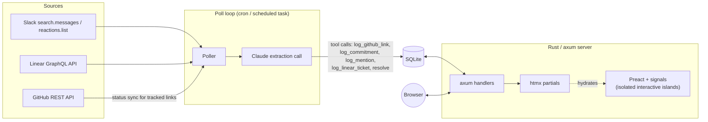
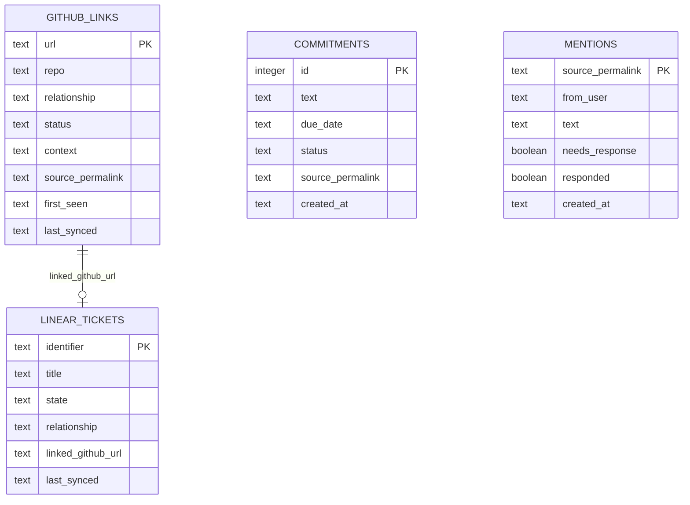
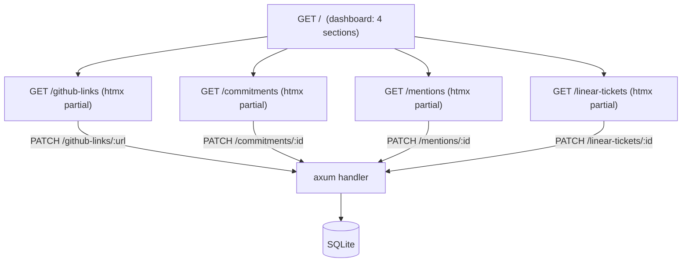
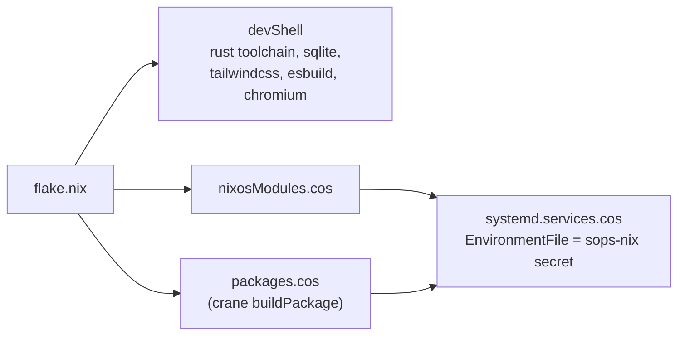

# cos — chief of staff

Tracks GitHub links you're involved in, commitments you make, and asks/mentions
directed at you across Slack and Linear, and surfaces them in a small local
dashboard.

## Scope (v1)

- Capture: Slack (user-token polling) + Linear (personal API key polling) +
  GitHub (status sync for tracked links)
- Extraction: Claude, given tool calls that write directly to SQLite
- Storage: SQLite, single file
- UI: simple CRUD dashboard — view, edit status, resolve, delete

No real-time push in v1. Everything is a poll loop on a schedule.

## System overview



## Ingestion sequence

```mermaid
sequenceDiagram
    participant Cron as Scheduler
    participant Poll as Poller
    participant Slack as Slack API
    participant Linear as Linear API
    participant Claude as Claude (tool-use)
    participant DB as SQLite

    Cron->>Poll: tick (e.g. every 5 min)
    Poll->>Slack: search.messages / reactions.list (since last_synced)
    Poll->>Linear: viewer.notifications / assignedIssues (since last_synced)
    Poll->>Claude: raw messages + tool defs
    Claude-->>DB: log_github_link / log_commitment / log_mention / log_linear_ticket
    Note over Claude,DB: Claude decides relevance;<br/>no-op if nothing worth logging
    Poll->>DB: update last_synced cursor
```

## Data model



## Extraction tool calls

Claude gets these as tool definitions during the extraction pass; it calls
whichever apply to a given message/event, or none:

| Tool | Purpose |
|---|---|
| `log_github_link(url, relationship, context, source_permalink)` | upsert by `url` |
| `log_commitment(text, due_date, source_permalink)` | insert |
| `log_mention(source_permalink, from_user, text, needs_response)` | upsert by `source_permalink` |
| `log_linear_ticket(identifier, relationship, linked_github_url)` | upsert by `identifier` |
| `resolve(table, id)` | mark done / responded / merged |

Each tool is a thin Rust fn: validate args, `INSERT ... ON CONFLICT DO UPDATE`.

## Web app

Plain CRUD, server-rendered, no SPA framework:

- **axum** router, one module per resource (`github_links`, `commitments`,
  `mentions`, `linear_tickets`), each exposing list/edit/delete handlers
- **tower** middleware: tracing, compression; no auth (localhost-only)
- **htmx** for all list/filter/delete/status-toggle interactions — handlers
  return HTML fragments, not JSON
- **Tailwind** for styling, compiled once at build time (no CDN/JIT at runtime)
- **Preact + signals** only where htmx genuinely isn't enough — e.g. an
  inline due-date editor with client-side validation before submit. Each such
  case is a standalone island: a tiny script mounted into a `<div
  data-island="...">`, not a shared app shell. Default to htmx; reach for an
  island only when state needs to live in the browser between requests.



## Project layout (proposed)

```
cos/
  flake.nix
  flake.lock
  nix/
    module.nix           # nixosModules.cos
  Cargo.toml
  src/
    main.rs              # axum app, router assembly
    db.rs                # sqlite pool, schema migrations
    models/
      github_link.rs
      commitment.rs
      mention.rs
      linear_ticket.rs
    routes/
      dashboard.rs
      github_links.rs
      commitments.rs
      mentions.rs
      linear_tickets.rs
    extraction/
      tools.rs           # tool defs + handlers for Claude tool-use
      poller.rs           # Slack/Linear/GitHub poll loop
  templates/              # askama or minijinja templates (htmx fragments)
  static/
    tailwind.css          # built output
    islands/              # preact islands, one file per interactive widget
  tailwind.config.js
  migrations/
```

## Decisions

- **Templating: minijinja**, not askama. Askama embeds templates at compile
  time, so every markup tweak forces a full `cargo build` — a bad loop for an
  agent iterating on fragments. Minijinja loads templates from disk at
  runtime; editing a `.html` file and refreshing the browser is enough.
- **Poll loop**: a `tokio::spawn`ed loop inside the same binary, no separate
  scheduler process.
- **Secrets**: read directly from the process environment
  (`std::env::var`), no `.env`/`dotenvy`. Locally, the CRUD/UI stages don't
  need any secrets at all; only the pollers do, and those are only exercised
  in the deployed NixOS service, where `sops-nix` supplies an
  `EnvironmentFile` to the systemd unit. No secret material lives in the repo
  or the dev shell.

## Nix



- **devShell**: rust toolchain (via rust-overlay/fenix), `sqlite`,
  `tailwindcss`, `nodejs`/`esbuild` (bundling the Preact islands),
  `cargo-watch`, and `chromium` for headless screenshotting. No network
  fetches at test time — everything pinned via the flake.
- **Build: crane**. `craneLib.buildPackage` with a separate `cargoArtifacts`
  derivation so dependency compilation is cached independently of source
  changes — matters once the poller/extraction code pulls in more crates.
  Exposed as `packages.default` / `packages.cos`.
- **NixOS module** (`nixosModules.default`): options for `enable`, `package`
  (defaults to this flake's `packages.cos`), `port`, `dataDir` (SQLite file
  location, via `StateDirectory`), and `environmentFile` (passed straight to
  systemd's `EnvironmentFile=`, pointed at a `sops-nix` secret path in the
  consuming NixOS config). The service runs with `DynamicUser = true`.
- **Headless browser testing**: `chromium --headless=new --screenshot=out.png
  --window-size=1280,800 http://localhost:$PORT` from the devShell is enough
  to visually verify dashboard/fragment rendering — no webdriver server, no
  extra deps. Since the app is server-rendered htmx, functional CRUD checks
  (create/patch/delete) are just `curl`/`httpie` against the routes; the
  browser is only needed to confirm layout and the Preact islands actually
  mount. This is what I'll use to check in with screenshots at each stage
  instead of describing UI changes in prose.

## Suggested build stages

1. `flake.nix` (devShell + crane package skeleton) + axum app scaffold +
   SQLite schema/migrations + static dashboard shell (no data yet) —
   screenshot the empty shell to confirm the toolchain works end to end
2. CRUD routes + minijinja/htmx partials for all four resources, seeded with
   fake data — screenshot each section
3. `nixosModules.cos` + systemd unit sketch (not deployed yet, just
   evaluable: `nix flake check`)
4. Linear poller + extraction tool calls (lowest-friction source, no app
   approval needed)
5. Slack poller once app is approved
6. GitHub status-sync job for tracked links
7. Any Preact islands, only if a CRUD interaction proves awkward in pure htmx
